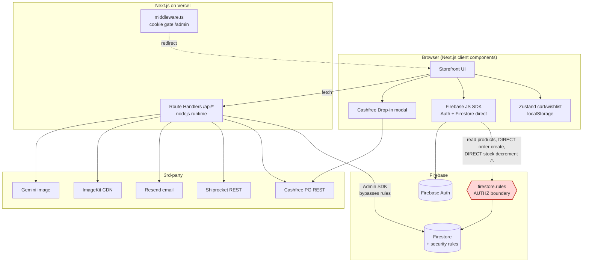

# 01 — Current Architecture

## Technology stack (from `package.json`)

| Layer | Choice | Version | Notes |
|-------|--------|---------|-------|
| Framework | Next.js (App Router) | ^15.3.8 | `--turbopack` dev; most routes `export const dynamic = "force-dynamic"` |
| UI runtime | React | ^19.0.0 | |
| Styling | Tailwind CSS v4 + `tw-animate-css` | ^4 | shadcn/ui (`components.json`, Radix primitives) |
| State | Zustand | ^5.0.12 | cart, wishlist, recently-viewed, admin add-product (localStorage-persisted) |
| Forms/validation | react-hook-form + zod | ^7.72 / ^4.3.6 | zod also validates API bodies |
| Auth + DB | Firebase JS SDK + firebase-admin | ^12.11 / ^13.10 | Firebase Auth + Firestore |
| Payments | Cashfree PG (REST, hand-rolled) | SDK ^1.0.7 (drop-in) | `lib/payments/cashfree-server.ts` uses `fetch`, API `2023-08-01` |
| Shipping | Shiprocket (REST) | — | serviceability + adhoc order booking |
| Email | Resend | ^6.12.3 | transactional only |
| Images | ImageKit (primary) + Cloudinary (legacy) + Firebase Storage | — | `lib/uploads/imagekit.ts`, `next.config.ts` remotePatterns |
| AI | Google GenAI (Gemini 2.5 Flash Image) | ^2.7.0 | admin "dress a model" image generation |
| Barcode/QR | jsbarcode, qrcode, html5-qrcode | — | POS/inventory scan flow |

**Hosting target:** Vercel (serverless/edge). Evidence: `middleware.ts` (edge), `*.vercel.app` allowlist in `lib/api/security.ts:99`, README mentions Vercel.

## Frontend architecture

- App Router with a mix of server components (e.g. `app/product-details/page.tsx` renders JSON-LD, then hands off to a `"use client"` `ProductDetailsClient`) and client components.
- Route groups: `(legal)` for policy pages, `account/`, `admin/`, `auth/`, `checkout/`, `explore/`, `order-confirmation/`, `product-details/`, `receipt/`, `wishlist/`.
- Global chrome via `components/StoreChrome.tsx`, `Header.tsx`, `Footer.tsx`, `AuthProvider.tsx` (context).
- Client state in `store/*` (Zustand + `persist`); SSR-safe storage shim `store/ssrSafeStorage.ts`.

## Backend architecture

There is **no separate backend** — server logic lives in Next.js Route Handlers under `app/api/*` (all `runtime = "nodejs"`, `dynamic = "force-dynamic"`), plus Firestore security rules as the real authorization layer. Admin SDK is initialized in `lib/server/firebase-admin.ts`.

API routes:

| Route | Purpose | Auth |
|-------|---------|------|
| `POST /api/orders/place` | Server-authoritative order creation | Optional bearer (guests allowed) + verified payment ref |
| `POST /api/orders/notify-status` | Email customer on status change | Admin bearer (role==="admin" only) |
| `POST /api/payments/cashfree/create-order` | Create CF order, return session id | None (origin+rate-limit only) |
| `POST /api/payments/cashfree/verify` | Server-to-server confirm SUCCESS payment | None |
| `POST /api/coupons/validate` | Eligibility + discount | Optional bearer |
| `POST /api/shiprocket/create-order` | Book shipment | (see `04`) |
| `GET /api/shiprocket/serviceability` | PIN serviceability | — |
| `GET /api/imagekit/auth` | Signed upload token | Admin bearer |
| `POST /api/admin/users/role` | Change roles | super_admin bearer |
| `GET /api/admin/users/list` | List users | admin bearer |
| `POST /api/admin/products/generate-image` | Gemini image gen | admin bearer |
| `POST /api/receipts/sign` | Sign POS receipt URL | (see `04`) |

## Data model (Firestore collections, inferred from code + rules)

- `products/{id}` — name, price (GST-inclusive), images[], category, stock (aggregate) and/or `sizes` map and/or color-variant structure (`lib/products/color-variants.ts`), archived/active flags, weightKg.
- `orders/{id}` — userId ("guest" or uid), orderNumber (8-char), items[], shippingAddress, pricing{subtotal,discount,shipping,gst,total,advancePaid,balanceDue,platformFee,ownerNet}, status, paymentMethod, paymentStatus, payment{provider,orderId,cfPaymentId}, shipping{...}, statusHistory[], inventoryRestored.
  - `orders/{id}/cancellationRequests/{reqId}` — customer-initiated.
- `users/{uid}` — email, displayName, photoURL, role, createdAt. `users/{uid}/orders/{id}` mirror, `users/{uid}/wishlist/{doc}`.
- `coupons/{CODE}` — type, value, maxDiscount, minSubtotal, expiresAt, newCustomerOnly, oncePerCustomer, usageCount. `coupons/{CODE}/redemptions/{uid}`.
- `cashfree_payments/{cfPaymentId}` — verification record (status "verified").
- `newsletter_subscribers/{id}` — email, createdAt.

## System architecture diagram

> The ⚠️ edge is the central risk: the browser can write orders and stock **directly** through Firestore, governed only by `firestore.rules`, in parallel to the guarded `/api/*` path.

## Environment / configuration

- `.env.example` documents all config. `NEXT_PUBLIC_*` (Firebase client, site URL, ImageKit public, Shiprocket pickup pincode) are browser-exposed by design. Server-only: `FIREBASE_SERVICE_ACCOUNT_JSON`, `CASHFREE_*`, `SHIPROCKET_*`, `RESEND_*`, `GEMINI_API_KEY`, `IMAGEKIT_PRIVATE_KEY`, `PLATFORM_FEE_INR`, `SUPER_ADMIN_EMAILS`, optional `ALLOWED_ORIGINS`.
- `CASHFREE_ENVIRONMENT` defaults to `sandbox`.
- No separate staging/production config files; environment separation is implicit (whatever env vars a given Vercel deployment has).

## Background jobs / scheduled tasks

**None.** No cron, no queue, no reconciliation worker. All "async" work is in-request `void (async () => …)()` fire-and-forget (order email in `orders/place/route.ts:471-498`; Shiprocket booking in `checkout/page.tsx:338-365`). This is a reliability gap (see `08`).

## Deployment architecture

Serverless functions per route on Vercel; Firestore as the only datastore; no container, no VPC, no self-managed infra. Firestore rules deployed via `npm run deploy:rules`.

## Existing test coverage

**Zero.** No `*.test.*`/`*.spec.*` files, no `test` script in `package.json`, no `.github/` workflows, no Playwright/Jest/Vitest config.

## Dead code / duplication / debt

- **Duplicate order-placement logic:** server `app/api/orders/place/route.ts` vs client `lib/checkout/placeOrder.ts` (direct Firestore write, used by POS `placePosSale`). The client path is also reachable by any attacker via the permissive rules (see `04`).
- `app/api/orders/place/route.ts:522-523` — `void Timestamp;` keeps an unused import alive (dead import).
- Cloudinary (`lib/cloudinary/upload.ts`) appears legacy alongside the newer ImageKit path (`lib/uploads/imagekit.ts`) — two image pipelines.
- `README.md` is the default create-next-app boilerplate (no project docs).
- `lib/auth/roles.ts` defines a `supervisor` tier with "no privileged screens yet" — defined-but-unused role.
- Guest checkout is implemented server-side (`orders/place` allows no bearer) but the checkout UI force-redirects signed-out users (`checkout/page.tsx:79-84`) — contradictory/partially-dead capability.
