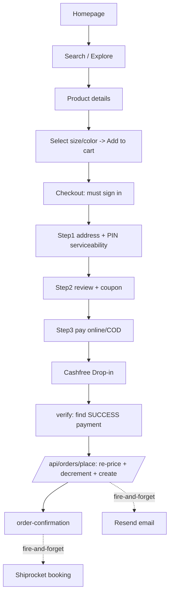
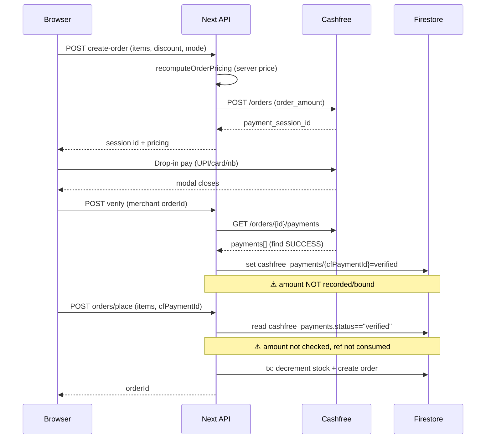
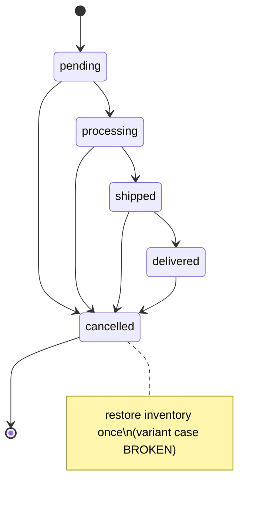
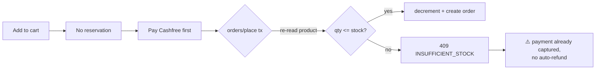
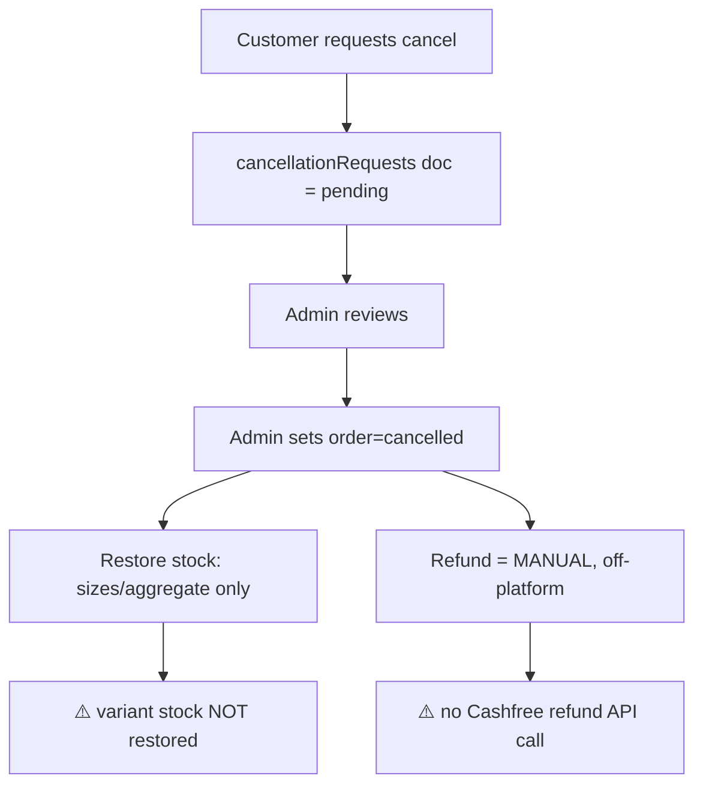
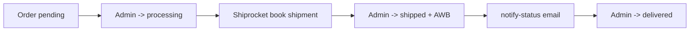

# 03 — End-to-End Customer Journeys

**Testing note:** journeys were **traced through source**, not executed (no running app / sandbox keys). Status = Pass / Fail / **Not Tested (static trace)**. No test results are fabricated.

## Reference diagrams

### Happy-path purchase journey

### Payment processing sequence

### Order state machine

Source: `allowedNextStatuses` (`lib/admin/orders-admin.ts:216-227`) mirrored in `firestore.rules:90-96`.

### Inventory reservation flow (as-is)

### Cancellation & refund flow (as-is)

### Admin order fulfillment flow

---

## Journeys 1–17

| # | Journey | Expected | Actual (traced) | Key files / APIs | Failure points | Status |
|---|---------|----------|-----------------|------------------|----------------|--------|
| 1 | New customer: browse→search→variant→cart→register→checkout→pay→confirm | Smooth, order created after payment | Works **only via UI**, but registration isn't required to be verified; "guest" stage replaced by forced sign-in | explore, product-details, AuthProvider, checkout, cashfree, orders/place | Email unverified; payment not amount-bound | Not Tested |
| 2 | Returning customer, saved address | Prefill + fast checkout | Single saved address from localStorage prefilled | `saved-delivery.ts`, checkout | Not cross-device | Not Tested |
| 3 | Guest checkout | Checkout without account | **UI redirects to sign-in** (`checkout/page.tsx:79-84`); backend would allow it | — | Guest path effectively disabled | **Fail (as product)** |
| 4 | Payment fails then retries | Retry succeeds, one order | User re-opens modal; new CF order each attempt; no dedupe | cashfree-client | Possible duplicate CF orders | Not Tested |
| 5 | Payment succeeds, browser closes immediately | Order created via webhook/reconcile | **No order** — verify+place never called; money captured | checkout:250-299 | No webhook/reconciliation | **Fail (P0-4)** |
| 6 | Payment succeeds but orders/place fails (stock race) | Auto-refund or retry | 409 toast; money captured; no refund | checkout:366-382, orders/place:457-469 | No compensating refund | **Fail (P0-4)** |
| 7 | Cancel + refund | Refund issued & tracked | Request doc only; admin cancels; refund manual | cancellation.ts, admin/orders | No automated refund | **Fail (P1)** |
| 8 | Return a delivered product | Return workflow + refund | **No return feature** | — | Missing | **Fail (missing)** |
| 9 | Buy multiple, return one | Partial return + partial refund | Not supported | — | Missing | **Fail (missing)** |
| 10 | Admin: create product→stock→process→ship | End-to-end admin | Code paths exist | admin/* | Variant restore bug on cancel | Not Tested |
| 11 | 100 buyers, last item | Exactly one wins, others clean fail | Server tx atomic → one wins; **99 losers who prepaid have captured payments and no order/refund** | orders/place tx:368-456 | Money stranded for losers | **Partial / Fail** |
| 12 | Price changes during checkout | Customer sees/approves new price | Server re-prices at place; but **amount paid not re-bound** → mismatch silently accepted | recompute-pricing, orders/place | Price/paid divergence | **Fail (P0-2)** |
| 13 | Coupon expires during checkout | Reject at place | `orders/place` re-resolves coupon live → rejects expired | orders/place:189-264 | OK for UI path | Pass (static) |
| 14 | Lose internet during payment | Safe recovery | Modal error → toast; no order; must retry | cashfree-client | If captured-then-dropped, see #5 | Not Tested |
| 15 | Webhook delivered multiple times | Idempotent, one order | **No webhook**; and verified ref is replayable at place | verify, orders/place | Replay possible | **Fail (P0-3)** |
| 16 | User A reads user B's order | Denied | Rules: order read requires admin or `userId==uid` (`firestore.rules:114-115`) | rules | OK, but create doesn't bind userId | Pass (static) |
| 17 | API price/discount manipulation | Rejected server-side | `/api/orders/place` rejects tampering; **BUT direct Firestore `orders` create accepts any price** | firestore.rules:113-126 | Full bypass | **Fail (P0-1)** |

### Detail: Journey 17 (price manipulation) — the master exploit

1. The Firebase **client** config is public (`NEXT_PUBLIC_FIREBASE_*`). An attacker uses the Firestore client SDK directly.
2. `firestore.rules:117-125` allows `create` on `/orders/{id}` for a doc with `status=="pending"`, a string `userId`, an 8-char `orderNumber`, `items` list, `shippingAddress` map, `validPricing(pricing)`, and `paymentMethod in [cod,online]`.
3. `validPricing` (`:101-109`) only checks non-negativity, `discount<=subtotal`, `shipping==0`, and `total==subtotal-discount+shipping`. **It never checks item prices against product docs.** So `subtotal` can be `1`.
4. The create rule does **not** use `hasOnly`, so the attacker can also add `paymentStatus:"paid"` and a fake `payment` map → the order looks fully paid in the admin UI.
5. Simultaneously, `clientInventoryDecrement` (`:228-255`) lets them decrement stock to match, so the order looks legitimate.

**Result:** fake paid orders at arbitrary prices, plus inventory drain. This is independent of, and defeats, the correct `/api/orders/place` logic.
